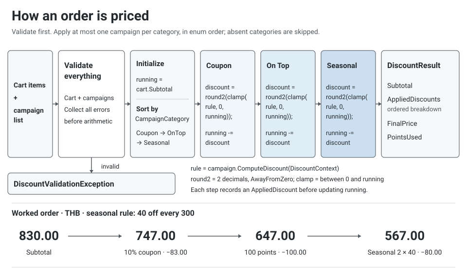
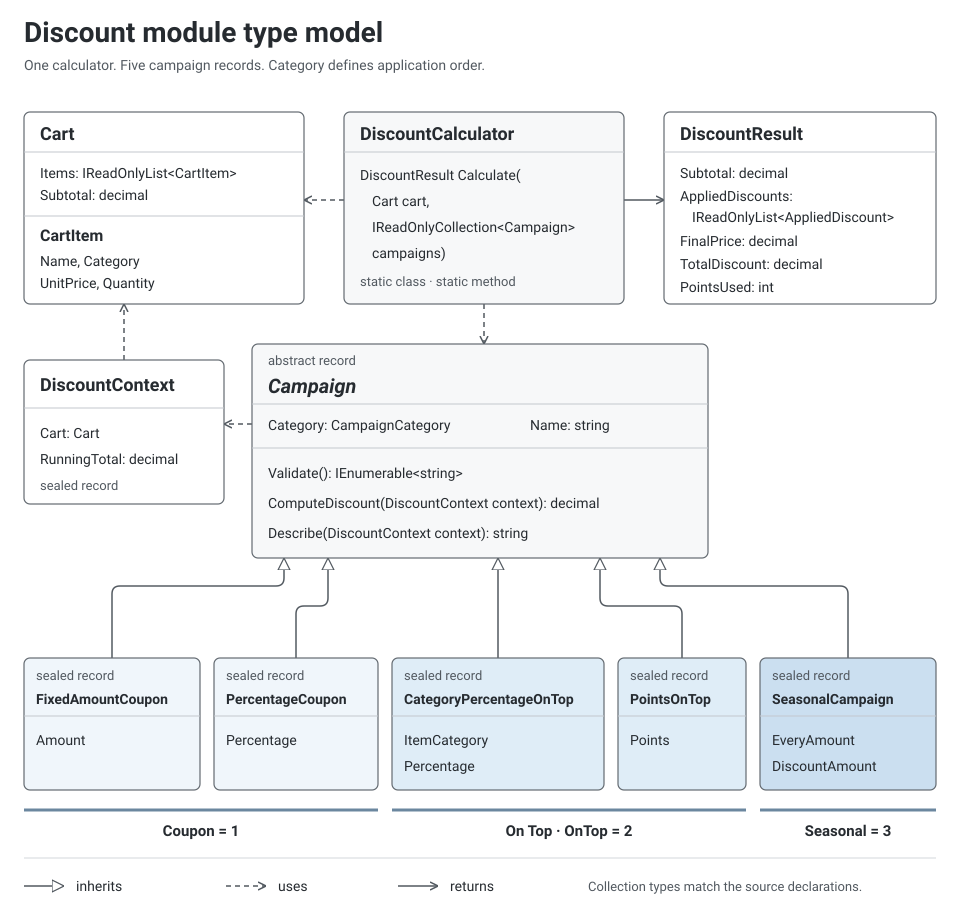

# Discount Module

A small, well-tested .NET library that calculates the final price of an order by applying discount
campaigns to the items in a shopping cart. Three thin front ends use it: a command line tool that reads
an order from a JSON file, a minimal HTTP API, and a web page served by that API for trying orders in a
browser. Built for the Playtorium developer take-home assignment.

- **Language / runtime:** C# 14 on .NET 10. `decimal` for money, records, no third-party packages in the
  module, the JSON library, the CLI or the API (the tests use xUnit and Microsoft.AspNetCore.Mvc.Testing);
  the web page is plain HTML, CSS and JavaScript with no framework.
- **Tests:** `dotnet test` runs all four test projects (see [Tests and quality checks](#tests-and-quality-checks)).
- **Design notes and assumptions:** [`docs/DESIGN.md`](docs/DESIGN.md), summarised below.

## Review in 5 minutes

1. Run it: `dotnet test`, then `dotnet run --project src/DiscountModule.Cli -- examples/06-all-categories.json`;
   or `dotnet run --project src/DiscountModule.Api -- --urls http://localhost:5080` and open <http://localhost:5080/>
   to price the same orders in a browser.
2. Read these files, in this order:
   - [`DiscountCalculator.cs`](src/DiscountModule/DiscountCalculator.cs): the whole algorithm in about 60
     lines. Copy the input, validate it, sort by category, apply each campaign, cap and round.
   - [`Campaign.cs`](src/DiscountModule/Campaigns/Campaign.cs) and [`PointsOnTop.cs`](src/DiscountModule/Campaigns/PointsOnTop.cs):
     how one campaign states its own rule.
   - [`CampaignListValidator.cs`](src/DiscountModule/Validation/CampaignListValidator.cs): one campaign per
     category, with every problem collected.
   - [`WorkedExampleTests.cs`](tests/DiscountModule.Tests/WorkedExampleTests.cs): the assignment's five examples as tests.
   - [`ExtensibilityTests.cs`](tests/DiscountModule.Tests/ExtensibilityTests.cs): a new campaign added without
     touching the calculator.
3. The decisions that shape the code:

| Decision | Why | See |
|----------|-----|-----|
| Two campaigns of one category are rejected, not resolved | a caller passing both has a bug, and picking one silently would hide it | A7 |
| Points and the seasonal campaign use the running total; the category percentage uses listed prices, capped at the category's share of the running total | follows the application order, and a category discount never lowers the price of another category | A1, A3 |
| Money is `decimal`, percentages have at most 2 decimals, inputs are bounded | every calculation is exact, so each discount is rounded exactly once | A8, A11 |
| Everything is validated before anything is calculated, and every problem is collected | invalid input never produces a price | [Validation](#validation-and-resilience) |
| The module knows nothing about JSON or HTTP | the CLI and the API are thin adapters over the same code | [Design notes](#design-notes) |

## What it does

| Campaign | Category | Rule | Parameters |
|----------|----------|------|------------|
| Fixed amount | Coupon | Subtract a fixed amount from the total | `amount` |
| Percentage discount | Coupon | Subtract a percentage of the total | `percentage` |
| Percentage discount by item category | On Top | Subtract a percentage of the listed price of every item in one category, at most that category's share of the price left | `category`, `percentage` |
| Discount by points | On Top | 1 point = 1 THB, capped at 20% of the total (fixed rule) | `points` |
| Special campaign | Seasonal | For every X THB of the total, subtract Y THB | `everyAmount`, `discountAmount` |

Rules from the assignment:

1. At most **one campaign per category** (Coupon, On Top, Seasonal). Two coupons, or a category
   discount together with points, is rejected as a usage error.
2. Campaigns are applied in the order **Coupon → On Top → Seasonal**, whatever order they are given in.
   Each discount is capped at the price left by the campaigns before it. Points and the seasonal
   campaign are also calculated from that remaining price. The category discount is a percentage of
   the listed prices of that category, capped at the category's share of the remaining price, so it
   never lowers the price of items in other categories (assumption A3).

The module returns the final price together with a step-by-step breakdown (price before, discount,
price after for every campaign) and the number of points actually used, so a caller can deduct them.



## Quick start

Requirements: [.NET SDK 10.0](https://dotnet.microsoft.com/download/dotnet/10.0), version 10.0.100 or later.

```bash
dotnet test                                                             # run all tests
dotnet run --project src/DiscountModule.Cli -- examples/06-all-categories.json
dotnet run --project src/DiscountModule.Api -- --urls http://localhost:5080   # then open http://localhost:5080/
```

```
Items
  1 x T-Shirt (Clothing) @ 350.00                                            350.00
  1 x Hat (Accessories) @ 250.00                                             250.00
  1 x Belt (Accessories) @ 230.00                                            230.00
Subtotal                                                                     830.00

Discounts (applied in order: Coupon > On Top > Seasonal)
  [Coupon] 10% off 830.00 THB                                                -83.00
  [On Top] 100 points (cap 149 = 20% of 747.00 THB)                         -100.00
  [Seasonal] 40.00 THB off every 300.00 THB of 647.00 THB (2 x 40.00)        -80.00

Total discount                                                              -263.00
Final price                                                                  567.00
Points used: 100
```

No .NET SDK installed? The tests also run in the official SDK container:

```bash
docker run --rm -v "$PWD:/src" -w /src mcr.microsoft.com/dotnet/sdk:10.0 dotnet test
```

Other ways to call the CLI:

```bash
dotnet run --project src/DiscountModule.Cli -- examples/04-points.json --json    # machine readable output
cat examples/01-fixed-amount.json | dotnet run --project src/DiscountModule.Cli -- -   # read from stdin
dotnet run --project src/DiscountModule.Cli -- examples/invalid-values.json      # see how errors are reported
dotnet run --project src/DiscountModule.Cli -- --help
```

Exit codes: `0` success · `1` the order breaks a discount rule · `2` the input could not be read or
understood (missing file, malformed JSON, unknown campaign type, bad usage) · `3` unexpected error.
Problems are printed on stderr, one per line.

## HTTP API

The same module behind one minimal ASP.NET Core endpoint. It takes the same JSON as the CLI and returns
the same result as the CLI's `--json` output.

```bash
dotnet run --project src/DiscountModule.Api -- --urls http://localhost:5080
curl -s -X POST http://localhost:5080/api/discounts -H "Content-Type: application/json" --data @examples/06-all-categories.json
```

| Status | When | Body |
|--------|------|------|
| 200 | the order is priced | the result: `subtotal`, `discounts`, `totalDiscount`, `pointsUsed`, `finalPrice` |
| 400 | the order cannot be read (malformed JSON, wrong shape, not UTF-8) | problem details, the problems in `errors` (up to 100) |
| 413 | the body is larger than 1 MiB | problem details |
| 415 | the body is not `application/json`, or it declares a charset other than UTF-8 | problem details |
| 422 | the order breaks a discount rule | problem details, the problems in `errors` (up to 100) |

Errors use RFC 9457 problem details (`application/problem+json`). 400 and 422 match the CLI's exit codes
2 and 1. The size limit is checked before the body is read and again while it is read, because a request
may not declare its size. The body must be UTF-8, as RFC 8259 requires for JSON: a UTF-8 byte order mark
is allowed, while invalid bytes or a UTF-16 byte order mark are refused.

This is a demo front end, not a production service: it has no authentication, rate limiting or HTTPS
configuration, which a real deployment would add in front of it.

## Web page

The API also serves a page at `/` (`src/DiscountModule.Api/wwwroot`) for trying orders without curl:

```bash
dotnet run --project src/DiscountModule.Api -- --urls http://localhost:5080    # then open http://localhost:5080/
```

- It opens with the combined example already priced. Six buttons load the five worked examples of the
  assignment and that combined order; each button shows the final price to expect.
- Items are edited in a table. Each campaign category is a row of coupon cards with **None** as the first
  card, so the one-campaign-per-category rule is built into the form: pick a card and set its numbers on
  the card itself; typing a number selects its card. The order is priced again a moment after any change; Enter in any field, or the button, prices
  it at once.
- The result panel shows the final price, the subtotal, the total discount and the points used, then one
  row per applied campaign, receipt style: the price before, the discount and the price after, with the
  description the API wrote. Once the order is changed, the old result
  is dimmed and the status says so until the order is priced again. **Request JSON** and **Response JSON**
  show exactly what was sent and what came back.
- 400, 413, 415 and 422 are shown with the API's title and every message in `errors`; a network failure or
  a non-JSON answer is reported as such.
- The page holds no pricing logic: it builds the JSON the endpoint accepts and renders what it returns. Where
  the browser lets `JSON.parse` see the source text of a number, amounts are kept as that text, so an amount
  near the limit of 1,000,000,000,000,000.00 THB shows every satang the API answered even though a JavaScript
  number could not hold it.
- Plain HTML, CSS and JavaScript, no framework or build step; it works offline and follows the system's light
  or dark scheme. Only `wwwroot` is served: any other path, a repository file included, answers 404 problem
  details like every unknown path.

## Input format

```json
{
  "items": [
    { "name": "T-Shirt", "category": "Clothing", "unitPrice": 350, "quantity": 1 },
    { "name": "Hat", "category": "Accessories", "unitPrice": 250 }
  ],
  "campaigns": [
    { "type": "Percentage", "percentage": 10 },
    { "type": "Points", "points": 68 },
    { "type": "Seasonal", "everyAmount": 300, "discountAmount": 40 }
  ]
}
```

- `category` is one of `Clothing`, `Accessories`, `Electronics`. `quantity` is a whole number and
  defaults to 1 when left out.
- `type` is one of `FixedAmount` (`amount`), `Percentage` (`percentage`), `CategoryPercentage`
  (`category`, `percentage`), `Points` (`points`), `Seasonal` (`everyAmount`, `discountAmount`).
- Property names, types and categories match in any letter case. Comments and trailing commas are allowed.
- `campaigns` may be empty or left out: the final price is then the subtotal.
- Files, stdin and HTTP bodies must be UTF-8; a UTF-8 byte order mark is allowed. A UTF-16 file is refused
  with a message saying so. Windows PowerShell 5.1 writes UTF-16 with `>`, so save order files with
  `Set-Content -Encoding utf8` there, or use PowerShell 7. It also pipes text to programs as ASCII, so a
  Thai item name piped to stdin arrives as `?`: run `$OutputEncoding = [System.Text.UTF8Encoding]::new()`
  first, or pass the file name instead.
- The file is checked strictly. Each shape problem is reported with its JSON path, up to 100 per order:
  a missing or unexpected property (even one set to `null`), a property given twice, a number written as a
  string, a fractional quantity, a number a `decimal` cannot hold exactly (such as `1e-30`), an escaped lone
  surrogate, an unknown type or category. Bytes that are not valid UTF-8 are reported with their position
  instead, because nothing after them can be read. `null` is never a valid value; leave an optional property
  out instead. When a campaign's `type` is missing or unknown, its other properties are not checked,
  because which ones belong depends on the type.

All files in [`examples/`](examples/) are runnable:

| File | Shows |
|------|-------|
| `01`–`05` | the five worked examples from the assignment |
| `06-all-categories.json` | one campaign of each category, listed in reverse order on purpose (the result is the same) |
| `07-points-capped-after-coupon.json` | the 20% points cap taken from the price after the coupon (558.00, 149 points used) |
| `08-coupon-then-category.json` | the category discount taken from listed prices after a coupon (170.00) |
| `09-category-capped-after-coupon.json` | the category discount capped at the category's share of the price left after a coupon (500.00) |
| `invalid-two-coupons.json` | the one-campaign-per-category rule (exit code 1) |
| `invalid-values.json` | six broken business rules reported together (exit code 1) |
| `invalid-format.json` | five problems with the file's shape reported together (exit code 2) |

## Using the module from code

```csharp
using DiscountModule;
using DiscountModule.Campaigns;
using DiscountModule.Models;

var cart = new Cart(
[
    new CartItem("T-Shirt", ItemCategory.Clothing, 350m),
    new CartItem("Hat", ItemCategory.Accessories, 250m),
    new CartItem("Belt", ItemCategory.Accessories, 230m),
]);

Campaign[] campaigns =
[
    new PercentageCoupon(10m),
    new PointsOnTop(100),
    new SeasonalCampaign(EveryAmount: 300m, DiscountAmount: 40m),
];

DiscountResult result = DiscountCalculator.Calculate(cart, campaigns);
// result.Subtotal == 830.00m, result.FinalPrice == 567.00m, result.PointsUsed == 100
// result.AppliedDiscounts: one entry per campaign, in application order

// Invalid input never yields a price: every problem is collected and thrown at once.
try
{
    DiscountCalculator.Calculate(cart, [new FixedAmountCoupon(50m), new PercentageCoupon(10m)]);
}
catch (DiscountModule.Validation.DiscountValidationException ex)
{
    // ex.Errors: ["Only one Coupon campaign can be applied per order (got: Fixed amount, Percentage discount)"]
}
```

## Adding a campaign in 3 steps

1. Add a record that derives from `Campaign` in `src/DiscountModule/Campaigns/`. It states its `Category`
   and `Name`, and implements `Validate()` (reusing `AmountRules` or `PercentageRules` where they fit),
   `ComputeDiscount()` and `Describe()`.
2. Add its tests. `DiscountCalculator` needs no change: ordering, the one-per-category rule, capping,
   rounding and the breakdown already apply to it. [`ExtensibilityTests.cs`](tests/DiscountModule.Tests/ExtensibilityTests.cs)
   shows this with an example campaign that exists only in the tests.
3. To accept it from JSON (the CLI and the API alike), add one entry to the table in
   [`CampaignTypes.cs`](src/DiscountModule.Json/CampaignTypes.cs).

## Assumptions

The assignment leaves a few points open. These are the readings used, with the reasoning in
[`docs/DESIGN.md` §6](docs/DESIGN.md):

| # | Assumption |
|---|------------|
| A1 | **"Total price" means the running total.** The 20% points cap and the seasonal "every X THB" use the price left by the campaigns before them, not the original subtotal. |
| A2 | **Points are whole units.** 1 point = 1 THB, so the cap is rounded *down* to a whole baht and `PointsUsed` is always an integer (running total 762.50 → cap 152). |
| A3 | **The category percentage uses the listed item prices, capped at the category's share of the running total.** That share is the running total spread over the items in proportion to their listed prices. Without the cap, a coupon plus a category discount could take more than the category's items are worth and lower the price of other categories (50% off the cart, then 80% off Clothing). Without a coupon the cap never applies. |
| A4 | **The category campaign's "Amount" is a percentage.** The parameter table says "Amount", the example says "15% Off on Clothing"; the example wins. |
| A5 | **Seasonal uses floor division** (830 THB at "40 for every 300" → 2 × 40), matching the example. `discountAmount` may not exceed `everyAmount`. |
| A6 | **The final price never goes below zero.** A 1,000 THB coupon on a 600 THB cart gives 0. |
| A7 | **One campaign per category is enforced, not resolved.** Two campaigns of the same category are rejected with a clear message rather than silently choosing one. |
| A8 | **Money is `decimal` at satang precision.** Prices and amounts may have at most 2 decimals, and so may percentages (12.5 or 33.33, not 33.333). Together with the limits in A11 this keeps every calculation exact, so each discount is rounded only once: half away from zero, to 2 decimals. The category cap (A3) needs a division; it is worked out exactly in satang with 128-bit integers and rounded once as well. |
| A9 | **Items carry a quantity** (`unitPrice × quantity`). |
| A10 | **A free item (price 0) is allowed; an empty cart is not.** |
| A11 | **Supported magnitudes:** prices and amounts up to 1,000,000,000 THB, quantities up to 1,000,000 per line, and an order subtotal up to 1,000,000,000,000,000 THB (one line at the maximum price and quantity). Larger values are rejected; within these bounds no calculation can overflow or lose a digit. |
| A12 | **Item categories in the examples.** The assignment names the items but not their categories. T-Shirt and Hoodie must be Clothing for the 2,382.50 example to work; Hat, Belt and Bag are taken as Accessories and Watch as Electronics. None of these choices changes any example's result. |

## Validation and resilience

`DiscountCalculator.Calculate` validates everything before it calculates anything, and reports **all**
problems in one `DiscountValidationException` (`Errors` has one message per problem):

- cart: missing or empty item list, missing items, blank name, negative or out-of-range price, a price
  with more than 2 decimals, quantity below 1 or above the limit, undefined category, a subtotal above
  the limit
- campaigns: missing entries, more than one campaign per category, amount ≤ 0, out of range or with more
  than 2 decimals, percentage outside (0, 100] or with more than 2 decimals, points below 1, seasonal
  threshold or discount ≤ 0, discount above the threshold, a campaign type reporting an undefined category

The calculator works on its own copy of the item and campaign lists, so a caller changing them from
another thread cannot slip an unchecked value between validation and calculation. Messages and
descriptions format numbers the same way on every machine, whatever its culture settings.

The front ends check the JSON in two passes. They first report the problems with the document's shape
(CLI exit code 2, HTTP 400). Once the shape is right, the module reports every broken business rule
(exit code 1, HTTP 422). A JSON syntax error stops the first pass at that error, since nothing after it
can be read reliably. The CLI prints text taken from the input, such as an item name, with control
characters escaped (`\n`, `\t`), so each item and each problem stays on its own line. The line and
paragraph separators U+2028 and U+2029 are escaped as well, because editors and pagers start a new line
at them. Characters that change the direction of the text, such as U+202E, are escaped too, so a name
cannot make a line read in another order.

The module itself reports every broken rule. The front ends list at most 100 of them, followed by a line
saying how many were left out. The JSON reader stops reading after 100 shape problems and ends the list
with "Stopped after 100 problems; fix these first", because how many are left is not known at that point.
Without these limits, a 1 MiB body of empty items would produce about a million messages, tens of
megabytes for a single request.

## Tests and quality checks

```bash
dotnet test                          # all four test projects
pwsh tools/mutation-check.ps1        # break the code on purpose and confirm the tests notice (a few minutes)
```

| Project | Tests | What they cover |
|---------|-------|-----------------|
| `DiscountModule.Tests` | 113 | worked examples, campaign rules and caps, application order, validation, breakdown, culture; 500 random orders from a fixed seed checked against rules that must always hold; an example campaign added without changing the calculator |
| `DiscountModule.Json.Tests` | 78 | every shape problem the parser reports, with its exact message and JSON path; strict UTF-8; the limit of 100 problems, also inside one object |
| `DiscountModule.Cli.Tests` | 51 | exit codes 0 to 3, text and JSON output, Thai item names, long names, control characters, line separators and direction overrides, UTF-8 files and stdin, the problem limit, and 3,600 damaged orders generated from a fixed seed (fuzzing) that must never crash the CLI |
| `DiscountModule.Api.Tests` | 47 | the HTTP endpoint running in memory: the same JSON as the CLI for every example order, 400, 413 at the exact byte limit, 415, 422, UTF-8 only, the problem limit, problem details; the web page at `/` with its script and style, and paths that are not files of the page |

- **Fuzzing found a real bug.** A JSON string holding an escaped lone surrogate, half of a UTF-16 pair,
  crashed the reader. It is now reported as an input error with its JSON path, and a test keeps it that way.
- **Mutation check.** [`tools/mutation-check.ps1`](tools/mutation-check.ps1) breaks 40 rules one at a time
  (rounding mode, sort order, caps, validation, JSON checks, strict UTF-8, output escaping, API limits, the
  problem limit, the web page) and runs every test after each change. All 40 are caught. It first runs the tests on the
  unchanged code and stops if any of them fails, since a failure could then not be blamed on a mutant.
- **CI.** [`.github/workflows/ci.yml`](.github/workflows/ci.yml) is a GitHub Actions workflow that builds the
  solution, checks its formatting with `dotnet format` and runs every test on each push to `main`, on pull
  requests and on demand.

## Project structure

```
src/DiscountModule/              the module (class library, no dependencies)
  Models/                        Cart, CartItem, ItemCategory
  Campaigns/                     Campaign base record, one record per campaign, CampaignCategory (+ display names), DiscountContext
  Validation/                    CartValidator, CampaignListValidator, AmountRules, PercentageRules, DiscountValidationException
  DiscountCalculator.cs          entry point: copy → validate → order → apply → breakdown
  DiscountResult.cs              the result; AppliedDiscount.cs is one step of the breakdown
  Money.cs, InputLimits.cs       satang rounding and formatting; supported magnitudes
src/DiscountModule.Json/         JSON shared by both front ends: OrderRequestParser, JsonObjectReader, CampaignTypes, PricedOrder
src/DiscountModule.Cli/          command line front end: text or JSON output, control-character escaping
src/DiscountModule.Api/          HTTP front end: POST /api/discounts; wwwroot/ is the web page (index.html, app.css, app.js)
tests/                           one test project per project in src/
tools/mutation-check.ps1         the mutation check
examples/                        runnable order files
docs/DESIGN.md                   binding design notes, assumptions, test matrix
docs/diagrams/                   the two diagrams used in this README
```



## Design notes

- **Each campaign owns its rule.** `Campaign` is an abstract record; every campaign type validates its
  own parameters, computes its own discount from a `DiscountContext` (cart + running total) and describes
  what it did for the breakdown. A new campaign is a new record, and `DiscountCalculator` does not change
  (open/closed). Accepting it from JSON takes one more entry in the `CampaignTypes` table.
- **The calculator owns the cross-cutting rules**: one campaign per category, application order,
  capping at the running total, rounding, and the breakdown. Those rules belong to the order, not to
  any single campaign.
- **Validate first, then calculate.** Invalid input never produces a price. Errors are collected so a
  caller (or a UI) can show everything that is wrong at once.
- **`decimal` everywhere.** In binary floating point `0.1 + 0.2` is `0.30000000000000004`; `decimal`
  stores baht and satang exactly. Rounding to 2 decimals happens once per applied discount.
- **Records with init-only properties** for input and output. The calculator never changes what it is
  given and returns a read-only breakdown.
- **Thin front ends.** The CLI and the API share the JSON reader and the result shape in
  `DiscountModule.Json`, and neither contains discount logic; the web page only builds the JSON the API
  accepts and shows what the API returns. The module itself knows nothing about JSON, consoles or HTTP.

## Trade-offs and next steps

Choices made on purpose:

- **Reject, don't resolve.** Two campaigns of one category are a usage error. A shop that wants "the best
  coupon wins" would drop that check and add a selection step to the calculator that prices each
  candidate and keeps the cheapest result. The campaign records themselves would not change.
- **Listed prices with a cap, not full pro-rata.** The category percentage is taken from listed prices and
  only capped at the category's share of what is left (A3). The other reading takes the percentage of that
  share itself: `examples/08` would then give 171.00 instead of 170.00. Switching would only change
  `CategoryPercentageOnTop`.
- **Exceptions for invalid input.** `DiscountValidationException` carries every problem. A team that prefers
  a result type could switch: `Calculate` would return it, and the two front ends that catch the
  exception today would check the result instead.
- **Validation in the calculator, not in record constructors.** Invalid campaigns can be created, so every
  problem is reported in one go instead of the first constructor throwing.
- **A hand-written JSON reader** instead of deserializing into classes. It is more code, but it reports each
  problem with its path (up to 100) and catches duplicate keys, `null` values and lost digits that a
  deserializer accepts silently.
- **No framework in the module**: no dependency injection, logging or validation library. It is a pure
  function, and the front ends can add those where they need them.

With more time:

- Validity dates and usage limits per campaign (seasonal campaigns usually run for a period).
- Spreading each discount over the items, which refunds, partial returns and tax per line need.
- Loading campaign definitions from configuration or a database instead of from each request.
- Authentication, rate limiting and idempotency keys before the API handles real orders.
- Currencies other than THB, and translated messages.

## Limitations

- The text output aligns columns for Latin and Thai text; wide East Asian characters are not measured.
  An item name wider than 60 columns is shortened there and ends in "…". The columns line up in Windows
  Terminal and other modern terminals; the legacy Windows console host (conhost) draws Thai vowel and tone
  marks in cells of their own, so a Thai name shifts its row there.
- The CLI and the API read the whole order into memory (the API refuses bodies over 1 MiB), which suits a
  shopping cart but not a bulk import.
- Amounts are THB only; there is no currency handling.
